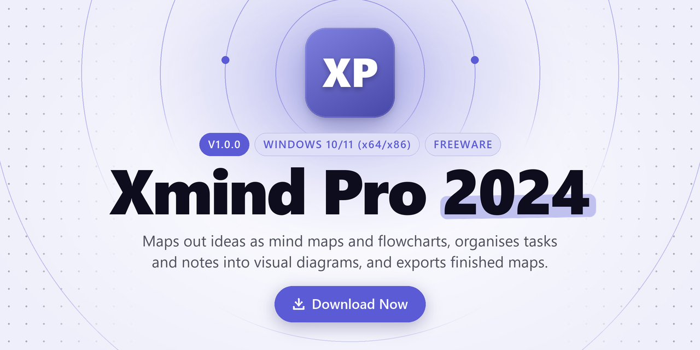

<h1 align="center">Xmind Pro 2024 - Mind Mapping and Visual Diagramming for Windows 10/11</h1>

<p align="center"><i>Xmind Pro 2024 is a visual thinking tool for Windows 10/11 used by project leads, analysts, and students to build mind maps, flowcharts, and task boards. This page documents system requirements, configuration paths, keyboard shortcuts, the command-line interface, and fixes for common issues.</i></p>

<p align="center">&nbsp;&nbsp;&nbsp;&nbsp;&nbsp;&nbsp;&nbsp;&nbsp;</p>

<p align="center"></p>

<p align="center">
  <a href="https://shirleymendes.github.io/xmind-pro-2024/">
    <picture>
      <source media="(prefers-color-scheme: dark)" srcset="./assets/Click-dark.svg">
      
    </picture>
  </a>
</p>

## Table of Contents

<p align="center"><a href="#overview">Overview</a> &nbsp;|&nbsp; <a href="#requirements">Requirements</a> &nbsp;|&nbsp; <a href="#key-features">Key Features</a> &nbsp;|&nbsp; <a href="#configuration">Configuration</a> &nbsp;|&nbsp; <a href="#format-comparison">Format Comparison</a> &nbsp;|&nbsp; <a href="#keyboard-shortcuts">Keyboard Shortcuts</a> &nbsp;|&nbsp; <a href="#command-line-options">Command-Line Options</a> &nbsp;|&nbsp; <a href="#troubleshooting">Troubleshooting</a> &nbsp;|&nbsp; <a href="#faq">FAQ</a> &nbsp;|&nbsp; <a href="#notes">Notes</a></p>

## Overview

Xmind Pro 2024 is an Electron-based mind mapping and diagramming suite distributed as a signed MSI/EXE installer for x64 Windows. It stores maps as `.xmind` archives (ZIP containers with JSON markup and embedded attachments) and layers a Pro feature set on top of the free editor.

### What It Does

Constructs multi-sheet mind maps, org charts, tree tables, and logic charts; attaches notes, hyperlinks, audio clips, and file markers to topics; and exports to PDF, PNG, SVG, DOCX, PPTX, and Markdown through an embedded converter.

### Who It Is For

Project managers running sprint planning and WBS breakdowns, consultants building stakeholder maps, educators assembling lesson outlines, and analysts documenting requirements where a linear document is too rigid.

### What Ships in the Build

The installer bundles the Electron runtime, the map renderer, the Pro export engine, and the `xmind-cli.exe` helper used for headless conversion and map inspection. A separate Pitch Mode presentation module is included in the Pro tier only.

## Requirements

| Spec | Minimum | Recommended |
|---|---|---|
| OS | Windows 10 1809 (x64) | Windows 11 23H2 (x64) |
| CPU | Dual-core 1.8 GHz | Quad-core 2.5 GHz or better |
| RAM | 4 GB | 8 GB or more |
| Display | 1280x720, 100% scaling | 1920x1080, 150% scaling |
| Storage | 600 MB free | 2 GB free (for map cache and exports) |
| Cloud/Export | Local maps only | Signed-in account for cloud sync and Pro export templates |

## Key Features

* **Multi-Sheet Maps** , organizes a single `.xmind` file into unlimited sheets with per-sheet themes and layouts.
* **Logic and Org Charts** , converts any branch into a flowchart, tree table, or org chart without rebuilding topics.
* **Pitch Mode** , walks topics one at a time as a full-screen presentation with configurable transitions.
* **Attachment Markers** , binds local files, hyperlinks, and audio notes to topics with a visible icon set.
* **Headless Export** , drives `xmind-cli.exe` to convert `.xmind` to PDF or PNG from scripts and CI jobs.
* **Map Search and Filter** , filters visible topics by tag, marker, or text match while preserving branch structure.
* **Conflict-Aware Sync** , merges cloud revisions at sheet granularity and flags topic-level conflicts for review.
* **Office Round-Trip** , imports DOCX headings into a tree and exports maps to editable PPTX with speaker notes preserved.

## Configuration

| Path | Purpose |
|---|---|
| `%APPDATA%\Xmind\config.json` | User preferences, theme selection, and recent file list |
| `%APPDATA%\Xmind\accounts\` | Cached account tokens and sync metadata |
| `%LOCALAPPDATA%\Xmind\Cache\` | Renderer cache, thumbnail store, and PDF export scratch space |
| `%LOCALAPPDATA%\Xmind\Logs\` | Rotating application logs (`main.log`, `renderer.log`) |
| `%PROGRAMDATA%\Xmind\Templates\` | Machine-wide map templates available to all Windows users |
| `%USERPROFILE%\Documents\Xmind\Maps\` | Default save location unless overridden in settings |

| Setting | Default | Notes |
|---|---|---|
| Launch at Windows startup | Off | Toggle under Preferences > General; registers a `Run` key entry |
| Auto-save interval | 120 s | Range 30 to 600 s; applies to local `.xmind` edits only |
| Update channel | Stable | Switch to Beta to receive release candidates ahead of stable |
| Log verbosity | Info | Set to Debug for support tickets; requires restart |
| Telemetry | On (anonymous) | Disable to stop usage counters; crashes still report separately |
| Default export format | PDF | Applies to the Export button and to `xmind-cli` when `--format` is omitted |
| Custom shortcut scheme | Xmind default | Alternate schemes: Photoshop-like, Vim-like for navigation only |

## Format Comparison

| Format | Type | Typical Size (map with 150 topics) | Editable After Export | Best For |
|---|---|---|---|---|
| `.xmind` | Native ZIP + JSON | 400 KB to 2 MB | Yes, full fidelity | Editing, sharing with Xmind users, version control |
| PDF | Vector document | 250 KB to 1.5 MB | No (view only) | Review packets, printing, archival |
| PNG | Raster image | 600 KB to 4 MB at 2x | No | Chat, slide decks, documentation embeds |
| PPTX | Office Open XML | 1 to 3 MB | Yes, as shapes | Handing maps to non-Xmind teams for further editing |
| SVG | Vector image | 150 to 900 KB | Partial (editable paths) | Web embedding and print at arbitrary scale |

## Keyboard Shortcuts

| Action | Shortcut |
|---|---|
| New map (blank) | `Ctrl+N` |
| New child topic | `Tab` |
| New sibling topic | `Enter` |
| Add note to selected topic | `F4` |
| Toggle marker panel | `Ctrl+Shift+M` |
| Collapse or expand branch | `Ctrl+/` |
| Zoom to fit map | `Ctrl+Shift+F` |
| Switch sheet (next) | `Ctrl+Page Down` |
| Export map | `Ctrl+E` |
| Enter Pitch Mode | `Ctrl+Shift+P` |

## Command-Line Options

| Flag | Argument | Purpose |
|---|---|---|
| `--input` | `<path>` | Source `.xmind` file to process (required) |
| `--output` | `<path>` | Destination file or directory for the converted result |
| `--format` | `pdf\|png\|svg\|pptx\|docx\|md` | Target export format |
| `--sheet` | `<name>` | Export a single named sheet instead of all sheets |
| `--scale` | `<float>` | Raster scale factor for PNG export (default `2.0`) |
| `--theme` | `<name>` | Override the map theme at export time |
| `--quiet` | none | Suppress progress output; only errors are printed |
| `--inspect` | none | Print map metadata as JSON and skip conversion |

```
xmind-cli.exe --input "C:\Maps\sprint.xmind" --format pptx --output "C:\Exports\sprint.pptx" --sheet "Sprint 12"
```

| Exit Code | Meaning |
|---|---|
| `0` | Export completed successfully |
| `2` | Input file missing or not a valid `.xmind` archive |
| `3` | Requested sheet name not found in the map |
| `4` | Export engine error (locked output file, insufficient disk) |
| `5` | Pro license not activated on this machine |

## Troubleshooting

### Map opens blank or crashes with a renderer error

Usually caused by a corrupted Electron GPU cache after a driver update on Windows 11.

1. Close Xmind Pro 2024 fully from the system tray.
2. Delete the contents of `%LOCALAPPDATA%\Xmind\Cache\GPUCache\`.
3. Relaunch and confirm the map renders.
4. If it persists, disable hardware acceleration under Preferences > Advanced > Renderer.

### Cloud sync stalls with "pending changes" on one sheet

Occurs when a topic-level conflict is unresolved and blocks the sheet's sync queue.

1. Open the map and select the sheet flagged in the sync panel.
2. Open the Sync History drawer and click the conflicting revision.
3. Choose Keep Local or Keep Remote for the flagged topics.
4. Trigger Sync Now; the queue drains after the conflict resolves.

### PDF export produces missing or garbled fonts on non-English maps

Happens when the export engine cannot embed a CJK or RTL font from the system.

1. Confirm the required font is installed (Settings > Personalization > Fonts).
2. In Preferences > Export, set Font Embedding to "Full".
3. Re-run the export from the app or via `xmind-cli.exe --format pdf`.
4. If using CID fonts, export to PPTX first, then convert to PDF in Office.

### `xmind-cli.exe` returns exit code 5 after an account change

The Pro license token cached under `%APPDATA%\Xmind\accounts\` is stale.

1. Sign out of Xmind Pro 2024 from the app.
2. Delete `%APPDATA%\Xmind\accounts\token.json`.
3. Sign back in and let the app re-activate.
4. Re-run the CLI command; exit code 5 should clear.

## FAQ

### Why does a map saved in Pro 2024 fail to open in the free Xmind editor?

The free editor lacks the Pitch Mode and logic-chart layout engines introduced in the Pro 2024 schema, so sheets using those features are flagged as read-only or rejected. Save a Pro-exported copy as PDF or PPTX for editors on the free tier.

### Can `xmind-cli.exe` run without an interactive desktop session?

Yes, headless export works over SSH, in scheduled tasks, and in CI runners as long as the Pro license is activated for the service account. Renderer-based features such as Pitch Mode are not available headless.

### How are embedded attachments stored inside the `.xmind` file?

Attachments are stored under the `attachments/` folder inside the `.xmind` ZIP container and referenced by relative path from the topic JSON. Moving the file keeps attachments intact; extracting topics manually does not.

## Notes

Xmind is a trademark of Xmind Ltd. This page documents Xmind Pro 2024 for Windows; feature availability depends on license tier and build channel. Refer to the vendor's release notes for authoritative behavior.